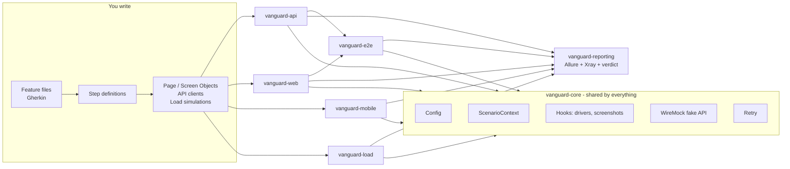

# Vanguard

Vanguard is a test automation platform for **API, web, mobile (Android + iOS), load and end-to-end** testing.
Every test is written in **Gherkin** (`Given / When / Then`).
All test types share one configuration, one HTML report (Allure) and one Jira Xray upload.

> **New here?** Start with the [Onboarding Guide](docs/ONBOARDING_GUIDE.md). It gets you from zero to your first passing test.

## How it fits together



| Module | What it tests | Tool |
|---|---|---|
| [vanguard-api](vanguard-api/README.md) | REST APIs | RestAssured |
| [vanguard-web](vanguard-web/README.md) | Websites in Chrome (desktop and phone-sized) | Selenium |
| [vanguard-mobile](vanguard-mobile/README.md) | Android and iOS apps, hybrid apps, phone browsers | Appium |
| [vanguard-load](vanguard-load/README.md) | Speed and stability under load | Gatling (Java, no Scala) |
| [vanguard-e2e](vanguard-e2e/README.md) | Journeys across layers (API → web) | All of the above |
| [vanguard-core](vanguard-core/README.md) | Shared building blocks; you rarely change it | |
| [vanguard-reporting](vanguard-reporting/README.md) | Combined report, Xray upload, final pass/fail | |
| [templates](templates/README.md) | Copy-paste starters for new tests | |

## Prerequisites

| For | You need |
|---|---|
| Everything | **JDK 21**, **Maven 3.9+**, **Google Chrome**, Git |
| Mobile tests | Node.js 20+, Appium 2 or newer, plus Android Studio (Android) or Xcode on a Mac (iOS). See [Mobile setup](docs/MOBILE_SETUP.md). |

Check your setup:
```bash
java -version    # should say 21
mvn -version     # should say Java version: 21
```

## 3-minute quick start

```bash
# 1. Run everything (API, web, load smoke, E2E). Mobile is skipped unless you add -Pmobile.
mvn clean verify

# 2. Run ONE module (always add vanguard-reporting so you get the verdict and the report)
mvn verify -pl vanguard-api,vanguard-reporting -am

# 3. Run only scenarios with a tag
mvn verify -Dcucumber.filter.tags="@smoke"

# 4. Watch the browser instead of running it hidden
mvn verify -pl vanguard-web,vanguard-reporting -am -Dbrowser.headless=false

# 5. Phone-sized Chrome for all web tests
mvn verify -pl vanguard-web,vanguard-reporting -am -Dbrowser.mode=mobile

# 6. Mobile tests (needs a device or emulator, see docs/MOBILE_SETUP.md)
mvn verify -Pmobile -pl vanguard-mobile,vanguard-reporting -am -Dmobile.platform=ios

# 7. Full load (default runs are capped at 5 users / 8 s)
mvn verify -pl vanguard-load,vanguard-reporting -am -Dload.profile=full

# 8. Open the combined HTML report in your browser
mvn -N allure:serve
```

At the end of every run you will see:

```
==================== VANGUARD RESULTS ====================
Module                   Passed   Failed  Skipped
vanguard-api                 12        0        0
vanguard-e2e                  3        0        0
vanguard-load                 5        0        0
vanguard-web                  8        0        0
==========================================================
[INFO] BUILD SUCCESS
```

If a scenario fails, it is listed under the table as `FAILED: <module> :: <scenario>` and the build fails.

## Project structure

```
vanguard/
├── pom.xml                      parent: all versions and plugins in one place
├── vanguard-core/               shared framework (config, ScenarioContext, hooks, WireMock stubs, Xray)
├── vanguard-api/                src/main: API clients, DTOs, schemas · src/test: API features + steps
├── vanguard-web/                src/main: Page Objects · src/test: web features + steps
├── vanguard-mobile/             src/main: Screen Objects · src/test: mobile features + steps
├── vanguard-load/               src/main: Gatling simulations · src/test: load features
├── vanguard-e2e/                src/test: cross-layer journeys (reuse the modules above)
├── vanguard-reporting/          runs last: merged Allure results, Xray upload, pass/fail verdict
├── templates/                   copy-paste starters (compiled, never run)
├── scripts/                     download-sample-apps for mobile
├── docs/                        guides (start with ONBOARDING_GUIDE.md)
└── .github/workflows/           CI pipeline
```

Rule of thumb: **reusable code goes in `src/main`, tests go in `src/test`**. Features live in `src/test/resources/features/`.

## Configuration

Settings come from `-Dname=value` on the command line, then from `vanguard-core/src/main/resources/config/<env>.properties`, then from the defaults below.
Secrets are never put in files. They come from environment variables.

| Key | Default | What it does |
|---|---|---|
| `env` | `qa` | Which `config/<env>.properties` file to load (`qa`, `staging`, `prod`) |
| `ui.base.url` | `https://www.saucedemo.com` | Website under test |
| `ui.password` | `secret_sauce` | Password of the public SauceDemo demo users |
| `api.base.url` | *(empty = built-in WireMock)* | API under test |
| `load.base.url` | *(empty = built-in WireMock)* | Load test target. **Only systems your team owns.** |
| `threads` | `4` (mobile: `1`) | Scenarios run in parallel |
| `retry.max.count` | `1` | Re-runs of a failed scenario (never for load) |
| `browser.mode` | `desktop` | `desktop` or `mobile` (phone-sized Chrome) |
| `browser.headless` | `true` | `false` shows the browser window |
| `emulation.device.name` | `Pixel 7` | Phone that Chrome pretends to be |
| `mobile.platform` | `android` | `android` or `ios` |
| `mobile.target` | `local` | `local` (emulator/device) or `browserstack` |
| `mobile.appium.url` | `http://127.0.0.1:4723` | Local Appium server |
| `mobile.appium.autostart` | `true` | Start Appium automatically if it is not running |
| `mobile.android.device` / `.version` | `emulator-5554` / *(any)* | Android device |
| `mobile.ios.device` / `.version` | `iPhone 15` / `17.5` | iOS simulator or device |
| `mobile.android.app` / `mobile.ios.app` | `apps/android/mda.apk` / `apps/ios/mda.app.zip` | App file, or a BrowserStack `bs://` id |
| `browserstack.build.name` | `Vanguard - <env>` | Build name on BrowserStack |
| `load.profile` | `smoke` | `smoke` (≤ 5 users, ≤ 8 s) or `full` |
| `visual.enabled` | `false` | Applitools checks; also needs `APPLITOOLS_API_KEY` |
| `visual.runner` | `ufg` | `ufg` (cloud: desktop + phone) or `classic` |
| `visual.batch.name` | `Vanguard - <env>` | Batch name in Applitools |
| `xray.upload.enabled` | `false` | Upload results to Jira Xray |
| `xray.mode` | `cloud` | `cloud` or `datacenter` |
| `xray.base.url` | `https://xray.cloud.getxray.app` | Xray Cloud, or your Jira Data Center URL |
| `xray.project.key` | `QA` | Your Jira project |

| Environment variable | Used for |
|---|---|
| `APPLITOOLS_API_KEY` | Visual tests |
| `XRAY_CLIENT_ID`, `XRAY_CLIENT_SECRET` | Xray Cloud upload |
| `XRAY_TOKEN` | Xray Data Center upload (personal access token) |
| `BROWSERSTACK_USERNAME`, `BROWSERSTACK_ACCESS_KEY` | Mobile tests on BrowserStack |

## More documentation

- [Onboarding Guide](docs/ONBOARDING_GUIDE.md): recipes for every test type
- [Step Catalogue](docs/STEP_CATALOGUE.md): ready-made steps you can use without writing Java
- [Gherkin Style Guide](docs/GHERKIN_STYLE_GUIDE.md)
- [Troubleshooting](docs/TROUBLESHOOTING.md): real error messages and how to fix them
- [Cheat Sheet](docs/CHEATSHEET.md): every command and tag on one page
- [Glossary](docs/GLOSSARY.md)
- [Mobile Setup](docs/MOBILE_SETUP.md)
